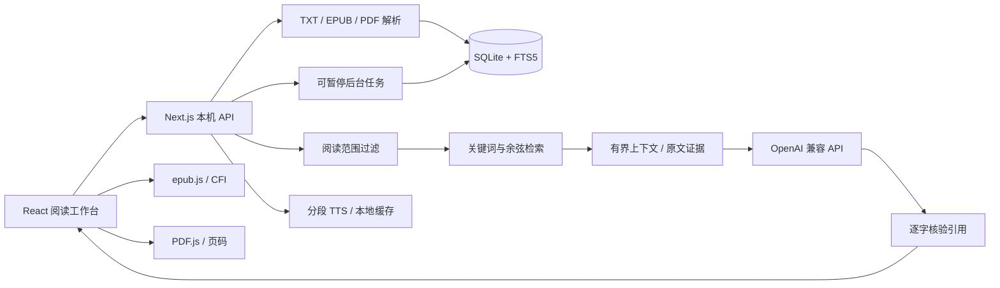

# 知间 · 技术架构

## 运行边界

单用户、本机 Node.js 24 进程。浏览器只调用本机 Next.js 路由；模型凭据和文件访问均位于 Node 服务端。服务默认绑定 127.0.0.1，路由拒绝非回环 Host、跨站 Origin 和 cross-site fetch。不适合作为公开网站部署。

## 文件结构

| 目录 | 职责 |
|---|---|
| `src/app` | 页面、错误恢复、样式与 API 路由 |
| `src/components/ReaderApp.tsx` | 阅读状态、书籍 / 章节导航、选文、三栏排版 |
| `src/components/OriginalView.tsx` | 懒加载 EPUB 与 PDF 原版引擎 |
| `src/components/Assistant.tsx` | 教授视角、阅读模式、历史讨论 |
| `src/components/Debate.tsx` | 分轮讨论、插话、纪要、双声朗读 |
| `src/components/Research.tsx` | 多书检索与可编辑研究报告 |
| `src/components/Archive.tsx` | 笔记、词汇、观点时间线与档案 |
| `src/components/AudioBar.tsx` | 系统语音 / 真实 API 语音、队列、暂停与倍速 |
| `src/lib/importer.ts` | 无模型依赖的文件导入与稳定段落定位 |
| `src/lib/db.ts` | SQLite 连接、事务与版本迁移 |
| `src/lib/rag.ts` | 读取边界、候选过滤、FTS5 / 余弦排名、引用核验 |
| `src/lib/ai.ts` | 教授框架、模式策略、有限历史与生成 |
| `src/lib/jobs.ts` | 游标任务、去重向量、递归摘要与恢复 |
| `src/lib/settings.ts` | 服务端配置与 AES-GCM 密钥加密 |
| `src/lib/backup.ts` | 一致性快照、ZIP 备份、事务恢复与回滚 |
| `migrations/` | 有版本的 SQL schema |
| `tests/` | 离线核心测试、实际文件样本生成、Playwright 场景 |

## 数据结构

书籍 → 章节 → 段落使用独立 UUID。段落 `seq` 是书内全局顺序，`ordinal` 是章内顺序。TXT 手动拆章移动段落与章内顺序，保留原有段落 ID 和 `seq`，因此笔记、高亮与引用不会失效。

原文件以 UUID 文件名保存在 `data/books`；文本和元数据进入数据库。书籍按原始文件 SHA-256 去重。EPUB 保留 OPF spine 路径，原版通过 epub.js 定位与 CFI 保存；PDF 每页作为可导航单位，段落保留实际页码与页内序号。

数据库包含需求中列出的 22 张业务表，额外包括向量缓存、分层摘要、阅读历史与 API 用量日志。外键开启，书籍删除级联删除其章节、段落、讨论、高亮；个人笔记保留内容并解除失效的出处关联。观点历史只有新增接口，避免覆盖过去的判断。

不采用 Prisma：当前使用 Node 24 内置 `node:sqlite`、显式 SQL 和 user_version 迁移，减少本机原生编译与生成器依赖。样式为原生 CSS，保留 React / TypeScript 与 Zustand，不依赖 Tailwind/shadcn 的构建链。这两点是对优先技术栈的具体取舍。

## 防剧透是数据访问边界

严格模式的边界是 `(seq, offset)`，offset 采用 JavaScript 字符偏移。检索只查询 `seq <= 当前 seq` 的段落，当前段落进一步裁剪到 offset。当前章模式额外允许同一章节，全文模式才允许整书。

- FTS 命中与本地关键词得分只可进入已过滤的候选集。
- 向量虽然可以离线提前建成，但只有允许的段落参与排名。边界段落只有完整读完后才能使用它的完整 embedding，避免未读后缀影响语义排名。
- 已存 AI 消息和辩论轮次带有生成时的可见上界。用户缩小范围或回到更早位置后，较广上下文生成的历史不会再次注入或回放。
- 摘要记录其最后覆盖的段落。边界段落没有完整读完时，该段的摘要不可见。章节和全书摘要同样按上界过滤。
- 模型返回的每条引文必须包含提供过的 passage ID，并逐字出现在当前允许的原文中；不匹配则剔除来源卡片。

这限制了输入数据，但不保证模型推理正确，也无法阻止模型凭训练知识猜测熟悉作品的后文。系统提示进一步要求不透露未提供内容。用户自己主动输入的信息不作为秘密后文过滤器处理。

## RAG 与分层摘要

导入时以自然段为基础切分，超过 1800 字符的段落沿句末切分，避免过大向量输入。FTS5 使用 trigram，短中文词补充本机关键词计分；语义检索将向量 JSON 存入 SQLite，按余弦相似度与文本得分组合排名。

后台向量任务每批 12 段；相同 hash 和 embedding 模型共享缓存。切换模型后续跑会检测游标以前的缺失向量，必要时从头扫描但复用已有缓存。

摘要按章节边界每批最多 8 段生成；再每组最多 5 份摘要递归汇总章节、全书。汇总同时提供代表原文，最终引文仍重新核验。中间归约节点也缓存，暂停后不必重做已完成归约。不会把全书拼接到一次请求。

当前向量检索在应用内线性计算，适合个人书库；大型语料应替换为 ANN / SQLite 向量扩展。排序是可解释的词法与余弦组合，尚非学习式 cross-encoder 重排。

## 模型与费用

使用安装版本的 AI SDK 6 和 `@ai-sdk/openai` 的 `.chat()` / `.embedding()`，直连用户指定 Base URL。TTS 走服务端 Audio Speech REST 接口。API Key 不下发客户端。

即时生成原文预算 42000 字符，任务内部指令最多 18000 字符（用户问题另限 6000）；最近历史最多 8 条，相关个人笔记最多 5 则。输出 tokens 可配置。单次生成超时 120 秒，用户可取消。失败不会写入成功消息。token 用量来自实际 SDK 响应。

大规模任务需要明确确认；导入不触发付费请求。长任务以游标、状态、错误和更新时间保存。应用重启后失去运行内存的任务转为暂停，不自动收费续跑。双教授自动推进最多 4 轮，每轮独立可取消。

## 音频

系统语音使用浏览器 SpeechSynthesis，是真实本机语音能力，无 API 依赖。可用声音取决于系统。AI 语音每段不超过 800 字符，按文本、声音、模型、Base URL 哈希缓存 MP3。双教授队列分别使用 nova / onyx。播放器支持暂停、继续、停止、段落跳转、速率与已加载音频的时间进度。

## 备份安全

记录在同一 SQLite 事务中获取一致性快照，ZIP 附带原文件与音频。密钥配置和 `.secret-key` 不导出。恢复只接受固定版本和允许表 / 字段，文件路径必须符合 UUID 白名单；检查解压大小、必需文件与外键。恢复前生成旧库 ZIP；记录恢复与文件写入失败时回滚数据库并恢复被覆盖文件。已有 API Key 留在本机，不从备份导入。

本版本备份全部在内存中压缩，250 MB 是上传包的边界，不适合数 GB 书库；后续可改为流式归档与分卷备份。
